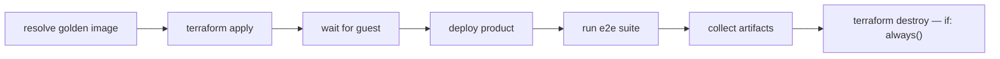

# HyperForge · flows

CI orchestration for [HyperForge](https://github.com/HariBoddapati01/hyperforge-core) — the ephemeral
hypervisor testbed that recreates lab VMs (KVM, Hyper-V, HPE VM Essentials) on
AWS for end-to-end product testing.

One workflow, a matrix of three independent legs:

Each leg (`kvm`, `vme`, `hyperv`) provisions its own host, runs in parallel
with its own Terraform state (`runs/<run-id>-<leg>.tfstate`), and tears down
unconditionally — `fail-fast: false` plus `if: always()` on destroy means one
leg's failure never strands another's infrastructure. The TTL reaper in
hyperforge-core is the backstop if even the destroy step dies.

## Triggering

- **Manual**: Actions → `e2e-hypervisor-matrix` → Run workflow. Pick legs
  (default all three) and the product build id to deploy.
- **Scheduled**: weekday nightly at 06:00 UTC, all legs.

## Required secrets

| Secret | Purpose |
|--------|---------|
| `AWS_CI_ROLE_ARN` | OIDC role assumed by the workflow — no long-lived keys |
| `TEST_SUBNET_ID` | Subnet for test hosts (from one-time account setup) |
| `TEST_SG_ID` | Security group (egress-only; host access via SSM) |

## Scripts

| Script | State | Does |
|--------|-------|------|
| `wait-for-guest.sh` | ✅ functional | Polls via SSM for the sentinel file the host AMIs drop once the guest VM is up (`/var/run/hyperforge-guest-started` on Linux, `C:\hyperforge\guest-started` on Windows) |
| `collect-artifacts.sh` | 🔶 partial | Grabs host console log; hypervisor + guest log collection TODO |
| `deploy-product.sh` | ⛔ placeholder | **Exits 1 on purpose** — wire in the product's real install mechanism |
| `run-tests.sh` | ⛔ placeholder | **Exits 1 on purpose** — point at the real e2e suite |

The placeholders fail loudly so a half-wired pipeline can never go green.

## Status

- [x] Workflow actionlint-clean, scripts shellcheck-clean
- [ ] Secrets not yet configured
- [ ] deploy/run scripts pending product integration
